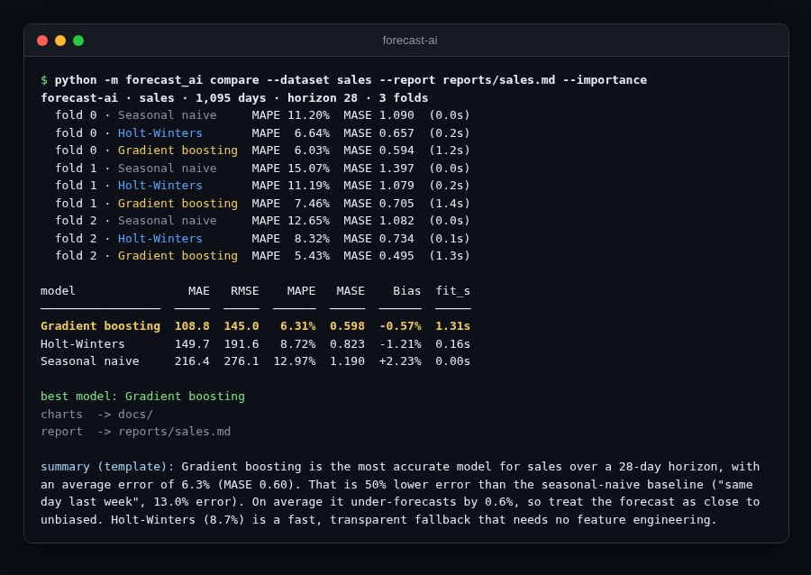
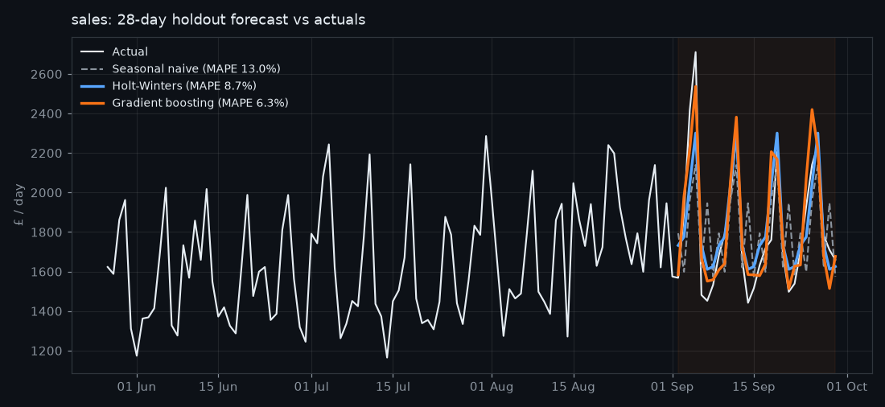
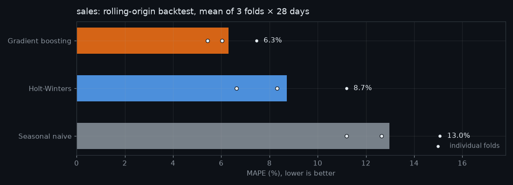
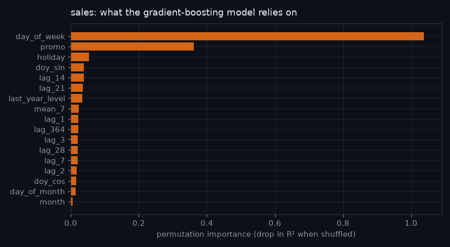
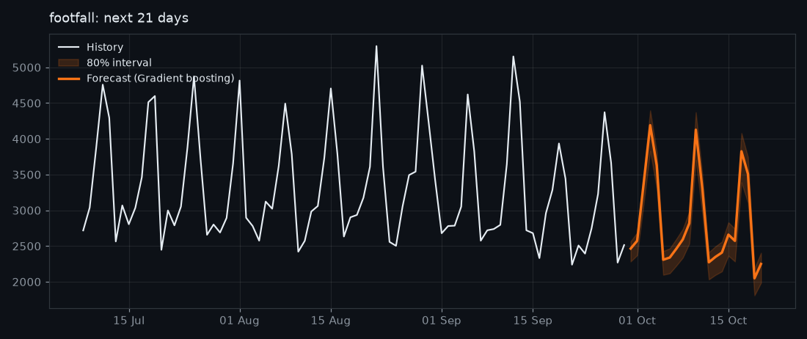

<div align="center">

# 📈 forecast-ai

**Retail time-series forecasting, done properly: a seasonal-naive baseline vs Holt-Winters vs gradient boosting, compared with rolling-origin backtests, charts and a plain-English report.**

[](https://github.com/hbtabi/forecast-ai/actions/workflows/ci.yml)


[](LICENSE)

</div>

Shops, cafés and venues want to know *how busy next week will be* so they can staff and stock properly. Plenty of
tutorials jump straight to a fancy model. **forecast-ai** does what a careful analyst would: it starts from a
baseline, adds a classical statistical model and a machine-learning model, and **backtests all three on the same
windows** so the comparison is honest.

Two realistic daily datasets are bundled (retail **sales** and store **footfall**, with UK bank holidays, promotions,
weekly and yearly seasonality, growth and weather shocks), so it runs **fully offline**. Point it at your own
`date,value` CSV to use real data. An optional **OpenAI-compatible LLM** writes the report summary; without a key a
deterministic template does.

## 📸 Demo

<p align="center"></p>

| Holdout forecast vs actuals | Backtest accuracy |
|---|---|
|  |  |
| **What gradient boosting relies on** | **Footfall: next 21 days with 80% interval** |
|  |  |

Full generated reports: [`reports/sales.md`](reports/sales.md) · [`reports/footfall.md`](reports/footfall.md)

### Results on the bundled data (3 folds × 28 days)

| Model | Sales MAPE | Sales MASE | Footfall MAPE | Footfall MASE |
|---|---:|---:|---:|---:|
| Seasonal naive (baseline) | 12.97% | 1.190 | 12.91% | 1.415 |
| Holt-Winters | 8.72% | 0.823 | 9.24% | 1.024 |
| **Gradient boosting** | **6.31%** | **0.598** | **7.57%** | **0.874** |

Gradient boosting wins mainly because it knows about **promotions and bank holidays** (see the importance chart),
which the purely time-based models cannot see. Holt-Winters is ~10× faster and needs no feature engineering, which
makes it a good fallback.

## ✨ Features

- **Three forecasters behind one `fit` / `predict` interface**
  - `SeasonalNaive`: "same day last week", the baseline everything must beat
  - `HoltWinters`: triple exponential smoothing (level, damped trend, weekly season) written in numpy, run in log
    space for multiplicative seasonality, smoothing parameters fitted by L-BFGS-B
  - `GradientBoosting`: scikit-learn `HistGradientBoostingRegressor` on lag, rolling, same-day-last-year, calendar,
    promo and holiday features, all **relative to the trailing 28-day mean** so trees can follow a growing business;
    forecasts recursively day by day
- **Rolling-origin backtesting** over several folds, with MAE, RMSE, MAPE, **MASE** and bias
- **Charts** (holdout forecast, backtest accuracy, permutation feature importance, future forecast with an 80%
  interval from backtest errors) saved as PNGs
- **Markdown report** with an executive summary from an OpenAI-compatible LLM, or an offline template
- **Bring your own data**: any CSV with `date` and `value` columns (sorted, de-duplicated, gaps interpolated);
  optional `promo` / `holiday` columns are used when present
- **UK bank-holiday calendar** (Easter computed from first principles) for future holiday flags
- **Planned promotions**: pass `--promo 2026-10-17 2026-10-18` to see their effect on the forecast

## 🚀 Quick start

```bash
git clone https://github.com/hbtabi/forecast-ai.git
cd forecast-ai
pip install -r requirements.txt

# Backtest all models, save charts to docs/ and write a report
python -m forecast_ai compare --dataset sales --report reports/sales.md --importance

# Forecast the next 14 days with the backtest winner, with an 80% interval
python -m forecast_ai forecast --dataset footfall --horizon 14 --chart forecast.png --out forecast.csv

# Your own data (columns: date,value[,promo,holiday])
python -m forecast_ai compare --dataset path/to/my_shop.csv --horizon 14

# Planned promotions on specific dates
python -m forecast_ai forecast --dataset sales --model gbm --promo 2026-10-09 2026-10-10
```

### LLM-written summaries (optional)

```bash
export OPENAI_API_KEY=sk-...                         # or LLM_API_KEY
export OPENAI_BASE_URL=https://api.openai.com/v1     # any OpenAI-compatible endpoint (Groq, OpenRouter, Ollama...)
export OPENAI_MODEL=gpt-4o-mini
python -m forecast_ai compare --dataset footfall --report reports/footfall.md
```

If the call fails for any reason, the report still gets the template summary and notes why.

### Use it as a library

```python
from forecast_ai.data import load_dataset
from forecast_ai.evaluate import backtest

df = load_dataset("footfall")
comp = backtest(df, horizon=28, folds=3)
print(comp.table())          # mean metrics per model, best first
print(comp.best_model())
```

## 🗂️ Project structure

```
forecast-ai/
├── forecast_ai/
│   ├── data.py         # synthetic sales/footfall generator, UK bank holidays, CSV loader
│   ├── models.py       # SeasonalNaive, HoltWinters, GradientBoosting
│   ├── metrics.py      # MAE, RMSE, MAPE, MASE, bias
│   ├── evaluate.py     # rolling-origin backtesting + comparison table
│   ├── charts.py       # matplotlib charts
│   ├── narrate.py      # LLM / template executive summary
│   ├── report.py       # Markdown report builder
│   ├── tables.py       # dependency-free Markdown/text tables
│   └── __main__.py     # CLI: compare / forecast / generate-data
├── data/               # bundled sales.csv and footfall.csv (synthetic, reproducible)
├── docs/               # charts and demo image
├── reports/            # generated example reports
└── tests/              # pytest suite
```

## 🧪 Tests

```bash
pip install -r requirements-dev.txt
pytest -q        # 16 tests: metrics, holidays, CSV cleaning, each model, backtests, LLM fallback, CLI end-to-end
ruff check .
```

## 🛣️ Roadmap

- [ ] Weighted ensemble of Holt-Winters and gradient boosting
- [ ] Quantile gradient boosting for model-based prediction intervals
- [ ] Weather and local-event features (e.g. Open-Meteo)
- [ ] Hourly footfall with intraday seasonality
- [ ] Streamlit dashboard for non-technical users

## 📄 Licence

[MIT](LICENSE) © 2026 Mohammed Hassan bin Tayyeb · Built in London at [Hasenix](https://github.com/hbtabi).
The bundled datasets are synthetic and generated by `python -m forecast_ai generate-data`.
