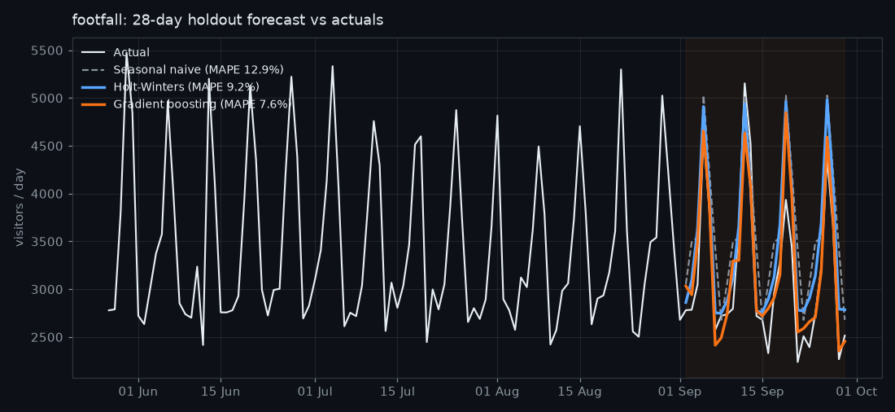
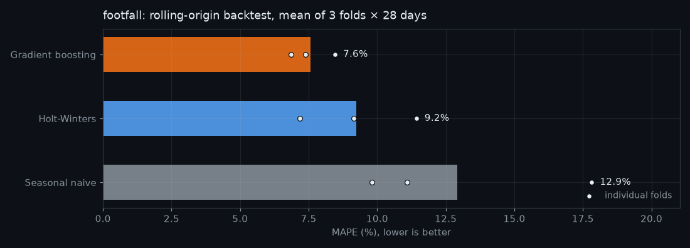
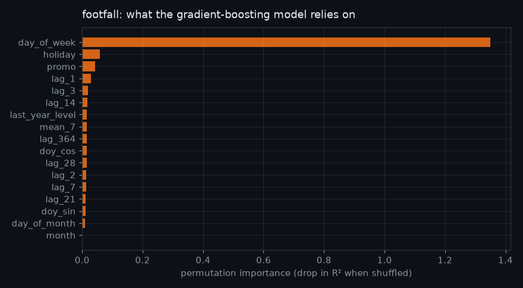

# Forecast report: footfall

_Generated 04 Oct 2026 20:18 by forecast-ai · 1,095 days of data (01 Oct 2023 to 29 Sep 2026) · horizon 28 days · 3 models × 3 backtest folds_

## Summary

**Gradient boosting** is the most accurate model for footfall over a 28-day horizon, with an average error of **7.6%** (MASE 0.87). That is **38% lower error** than the seasonal-naive baseline ("same day last week", 12.9% error). On average it under-forecasts by 2.3%, so consider adjusting stock or staffing plans accordingly. Holt-Winters (9.2%) is a fast, transparent fallback that needs no feature engineering.

Summary written by: `template`

## Backtest results (mean across folds)

| model | MAE | RMSE | MAPE | MASE | Bias | fit_s |
|---|---:|---:|---:|---:|---:|---:|
| **Gradient boosting** | **254.4** | **349.3** | **7.57%** | **0.874** | **-2.30%** | **1.14s** |
| Holt-Winters | 298.0 | 380.3 | 9.24% | 1.024 | +3.88% | 0.22s |
| Seasonal naive | 411.6 | 505.6 | 12.91% | 1.415 | +5.28% | 0.00s |

MAPE = mean absolute % error · MASE < 1 beats "same day last week" · Bias > 0 = over-forecasting

## Holdout forecast

## Backtest accuracy

## Feature importance

## Model notes

- Holt-Winters fitted smoothing parameters: alpha = 0.045, beta = 0.058, gamma = 0.072, phi = 0.979
- Gradient boosting uses lags 1-28, a 7-day mean, same-day-last-year and calendar/promo/holiday features, all relative to the trailing 28-day mean so it can follow growth.
